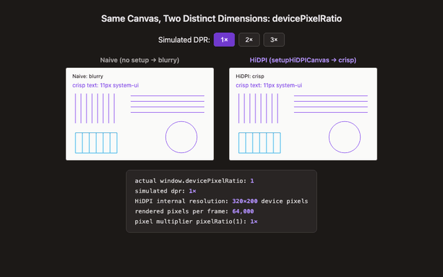

# Same Canvas, Two Different Sizes — devicePixelRatio

[](https://m2-md.github.io/hidpi-canvas-devicepixelratio/)
[](https://javascript.plainenglish.io/why-does-canvas-look-blurry-on-retina-displays-devicepixelratio-and-the-tale-of-two-sizes-2be8f6e6f7f8?source=friends_link&sk=3c3af29a65f3d3238efd567f24c20b00)
[](https://www.buymeacoffee.com/mkare/e/599265)
[](./tsconfig.json)



> Solving blurry canvas rendering on Retina/HiDPI displays: backing store buffer scaling, CSS pixel alignment, and measuring the quadratic dpr² fill-rate performance tax.

## 2D Canvas & Game Physics Series

| Part | Topic | Live Demo | Free Guide (Friend Link) |
| :--- | :--- | :--- | :--- |
| **Part 1** | **2D Rigid-Body Physics & Slingshot** | [▶ Play Demo](https://m2-md.github.io/canvas-physics-from-scratch/) | [📖 Read Free](https://javascript.plainenglish.io/how-game-physics-works-building-a-2d-physics-engine-from-scratch-in-canvas-5cd26416ddb8?source=friends_link&sk=f9c8048fe5b2d513b3c0d26127e97fb4) |
| **Part 2** | **HiDPI Canvas & `devicePixelRatio`** *(this repo)* | [▶ Live Comparison](https://m2-md.github.io/hidpi-canvas-devicepixelratio/) | [📖 Read Free](https://javascript.plainenglish.io/why-does-canvas-look-blurry-on-retina-displays-devicepixelratio-and-the-tale-of-two-sizes-2be8f6e6f7f8?source=friends_link&sk=3c3af29a65f3d3238efd567f24c20b00) |
| **Part 3** | **Fixed Timestep & Render Interpolation** | [▶ Live Metronome](https://m2-md.github.io/fixed-timestep-render-interpolation/) | [📖 Read Free](https://javascript.plainenglish.io/metronome-physics-fixed-timestep-game-loops-and-render-interpolation-in-typescript-cdf54ec5ea11?source=friends_link&sk=ff5390a11e2d97b29e82dc41a6572272) |
| **Part 4** | **Object Pools & Zero-Allocation Loops** | [▶ Pooled vs Unpooled](https://m2-md.github.io/object-pools-zero-allocation/) | [📖 Read Free](https://medium.com/@mkare/return-the-cart-clear-the-exit-object-pools-and-zero-allocation-loops-in-canvas-4051c97ff8a7?source=friends_link&sk=2ed006e6c639a47b92eb324d11a664a6) |
| **Part 5** | **Dirty Rectangle Rendering in Canvas 2D** | [▶ Dirty Rect Visualizer](https://m2-md.github.io/dirty-rectangle-rendering/) | [📖 Read Free](https://medium.com/@mkare/no-need-to-wipe-the-whole-table-dirty-rectangle-rendering-in-canvas-2d-50de001bf7b1?sk=8798d90f87a4c6b379f6d18dc68fe93b) |
| **Part 6** | **Broad-Phase Collision & Spatial Hashing** | [▶ Naive vs Spatial Grid](https://m2-md.github.io/broad-phase-collision-spatial-hash/) | [📖 Read Free](https://medium.com/@mkare/shaking-hands-with-everyone-broad-phase-collision-and-spatial-hashing-from-200-to-20-000-bodies-a5d1628b85a2?sk=029ce9604f262a1350dc835d2b899eb3) |

> 📦 **Want the bundled TypeScript Starter Kit + cheatsheets?** Grab the [TS 2D Canvas Physics & HiDPI Starter Kit](https://www.buymeacoffee.com/mkare/e/599265) (or unlock it free with a [Buy Me a Coffee membership](https://www.buymeacoffee.com/mkare)).

Working code for the article "Same Canvas, Two Different Sizes: Ending the Blur
with devicePixelRatio". It shows why a canvas goes blurry on a Retina/HiDPI
display, how to sharpen it by separating the internal resolution (device pixels)
from the displayed size (CSS pixels), and what that sharpness costs in `dpr²`
fill-rate.

Three layers:

1. **Pure scaling math** (`src/scale.ts`) — never touches the DOM. `deviceSize`,
   `cssToDevice`, `deviceToCss`, `alignHalfPixel`, `pixelRatio`. Every test calls
   only this → deterministic, headless.
2. **Canvas/DOM layer** (`src/hidpi.ts`) — `setupHiDPICanvas`, `watchDprChange`
   (catches dpr changes via `matchMedia`), `resizeToDisplaySize`. Not tested
   (headless vitest has no `canvas`, no `window.devicePixelRatio`, no `matchMedia`).
3. **Demo** (`src/main.ts` + `index.html`) — two canvases side by side: naive (blurry)
   vs HiDPI (sharp), a 1×/2×/3× dpr simulation switch, a live pixel counter.

## Setup

```bash
npm install
```

## Running

```bash
npm run dev
```

`http://localhost:5173/` → the side-by-side demo. **It will not open over `file://`; a dev server is required.**

- The left canvas is the naive setup (no fix): the scene is drawn at CSS
  resolution and then scaled up to device resolution → the higher the dpr, the blurrier it gets.
- The right canvas is HiDPI via `setupHiDPICanvas`: it stays sharp at every dpr.
- The 1×/2×/3× switch at the top changes the simulated dpr; the pixels painted
  per frame in the HUD grow `1× → 4× → 9×`.
- If you drag the window onto a monitor with a different DPI,
  `dpr X: pixel multiplier Y×` is logged to the console (`watchDprChange`).

To see the visible blurry/sharp difference most clearly, look at the thin lines
and the 11px text; on a real HiDPI display, or under DevTools device emulation
(the DPR setting), the difference is obvious to the naked eye.

## Test

```bash
npm test
```

13 pure tests verify the scaling math: `deviceSize` rounding (dpr 1/2/3 +
fractional), the `cssToDevice`/`deviceToCss` round-trip, `alignHalfPixel` half-pixel
alignment, `pixelRatio` quadratic ratio. None of them calls a DOM API.

Expected output:

```
 ✓ test/scale.test.ts (13 tests)
 Test Files  1 passed (1)
      Tests  13 passed (13)
```

## Bench

```bash
npm run bench
```

Shows that fill-rate grows with `dpr²`, both arithmetically and as measured.
There is no canvas in headless node; the "painted pixel" cost is measured by
clearing and filling as many RGBA bytes as there are device pixels every frame
(a clearRect + fillRect analogue).

Sample output (Node v22, Apple Silicon; varies by machine):

```
Fill-rate table (400×300 CSS, 60 FPS) — pure arithmetic
  dpr  internal res    pixels/frame       pixels/second
    1        400×300          120,000            7.2M
    2        800×600          480,000           28.8M
    3       1200×900        1,080,000           64.8M

Measured cost (clear+fill, 200 frames) — dpr² trend verification
  dpr  internal res      ms/frame  ratio to 1x  expected dpr²
    1        400×300      0.179        0.95×             1×
    2        800×600      0.736        3.89×             4×
    3       1200×900      1.661        8.78×             9×
```

The measured `ratio to 1x` column follows the expected `dpr²` (1×/4×/9×) trend;
the small deviations are measurement noise.

## Build

```bash
npm run build   # tsc && vite build
npm run typecheck
```

## File layout

```
src/
  scale.ts      # pure scaling math (the only tested layer)
  hidpi.ts      # canvas/DOM layer: setup, watchDprChange, resize
  main.ts       # demo: naive vs HiDPI, dpr switch, HUD
  bench.ts      # fill-rate table + measured cost
  bench-cli.ts  # prints the bench output
test/
  scale.test.ts
index.html
```

## License

MIT
